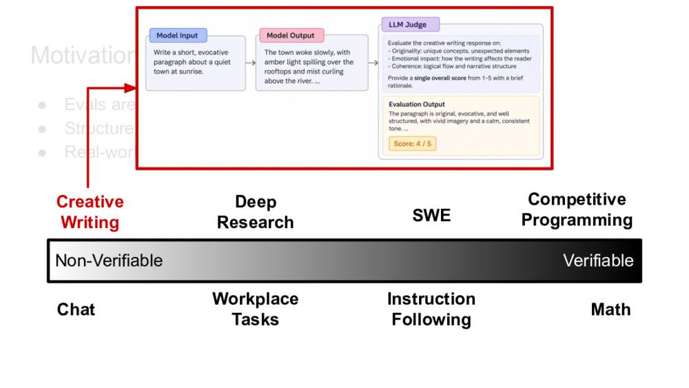
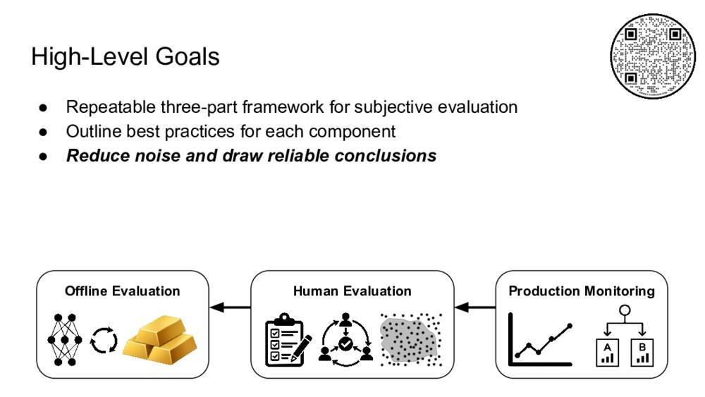
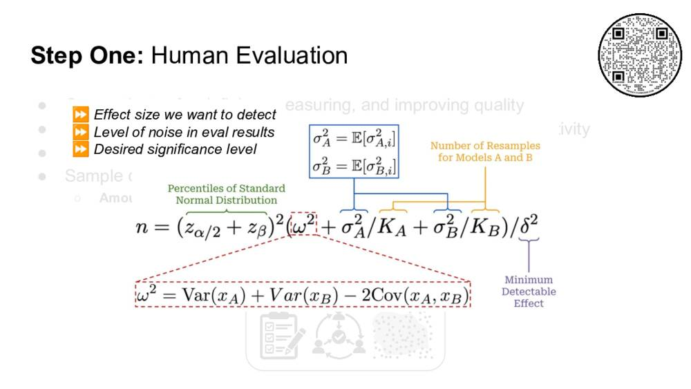
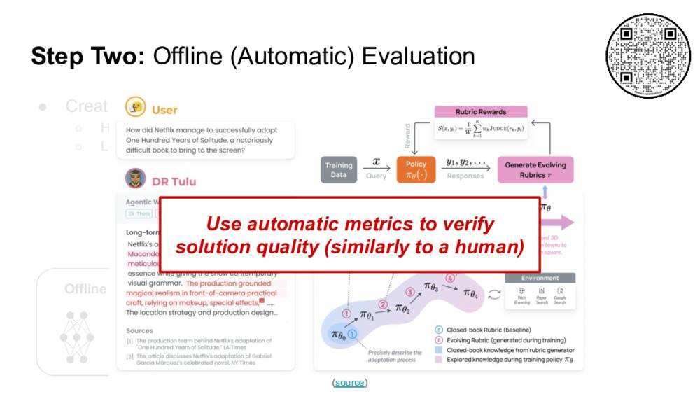
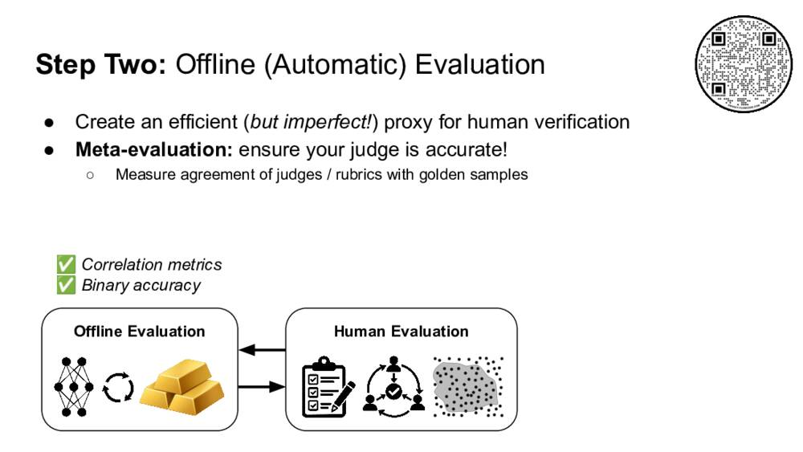
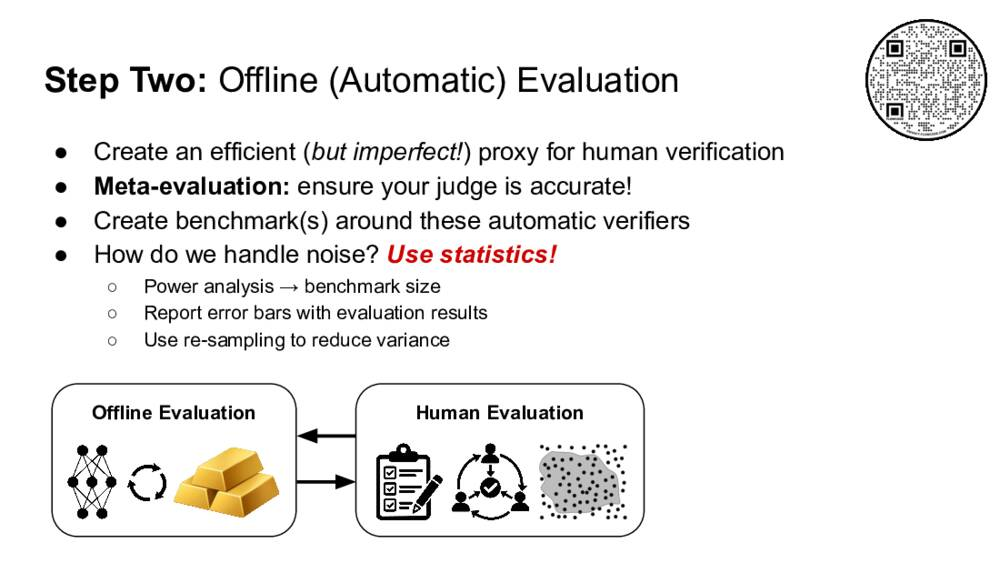
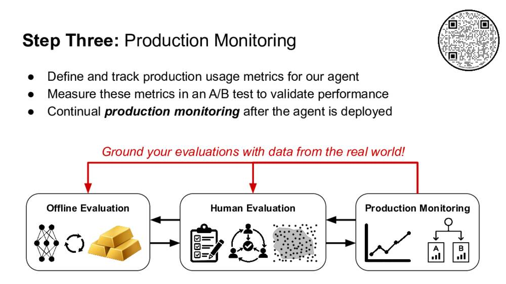
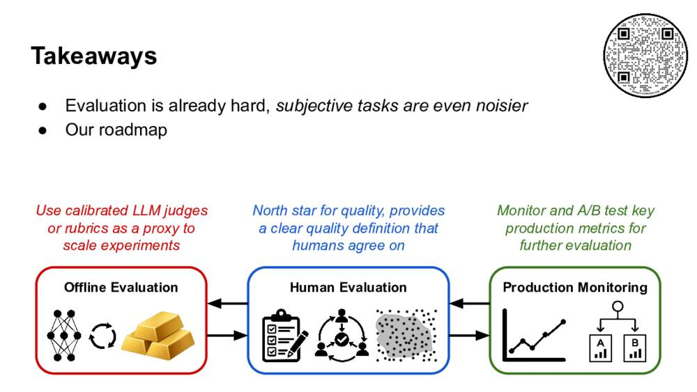

**English** | [中文](zh/10-14-1520-a-roadmap-for-evaluating-highly-subjecti.md)

# Evaluating Subjective Tasks Means Fighting Noise at Every Step

*At AI Engineer NYC 2026, Netflix's Cameron Wolfe laid out a three-part roadmap for evaluating tasks with no right answer: human evaluation as the definition of quality, LLM judges as a checked proxy for it, and production monitoring as the final test, with statistics used throughout to tell real improvements from noise.*

**Breakout · Wednesday, October 14, 2026 · 3:20–3:38pm · Turing Room (Riverside Ballroom) · Evaluations Track**
**Speaker:** Cameron R. Wolfe, Staff Research Scientist, Netflix (author of the Deep (Learning) Focus newsletter)

*The talk's second slide pointed to the deck and every reference at cameronrwolfe.me/links.*

---

"We're going to go over a lot of information," Cameron Wolfe began. "It's supposed to be kind of like an overview." The second slide carried a QR code and a link to the full deck and to Wolfe's longer articles, for anyone who wanted the details.

Wolfe's subject was evaluation for tasks such as creative writing or deep research, where there is no single correct answer. The 17-minute talk built a repeatable framework in three parts, then added a fourth step, repeating it, and returned again and again to one theme: noise.

The author photographed only that one slide. The slide images below come from Wolfe's public deck, which the talk followed page by page.

## 1. Why evaluation is hard, and subjective evaluation harder

Evaluation is difficult, Wolfe said, and the evidence is everywhere: "People are talking about benchmaxxing constantly. There's new evals being released like every day and different revisions to evals." The opening slide collected examples, including a chart titled "The Benchmark Landscape Is Exploding" and OpenAI's post explaining why SWE-bench Verified "no longer measures frontier coding capabilities."

The deck gave three reasons. **Scope**: models and agents have broad capabilities across diverse tasks and domains. **Cost**: benchmarks contain many test cases that can be long-running or expensive. **Noise**: "non-determinism (from several sources) makes the evaluation process variable." The slide boxed Noise and labeled it "This talk!" Noise, Wolfe said, "just makes it really difficult to draw reliable conclusions from the results."

To show where the noise comes from, Wolfe walked through the structure of an evaluation trial. An evaluation suite is a set of tasks. Each task goes to a model plus harness, which the slide marked "non-deterministic," and which produces a trajectory and an outcome. A grader then gives pass or fail. Cost keeps the task set small ("Small to limit cost," the slide said); on stage Wolfe said some recent benchmarks "will cost like, you know, $50,000, $100,000 to run." A small task set plus a non-deterministic agent already makes results hard to rely on.

Most recent evaluation work, Wolfe noted, focuses on verifiable tasks, where the grader is deterministic: "string match, symbolic verification, executable test cases, and more."

*Slide from Cameron Wolfe's public deck: real-world tasks on a spectrum from non-verifiable to verifiable, with a creative-writing example graded by an LLM judge.*

But real tasks lie on a spectrum. The slide placed them from non-verifiable to verifiable: creative writing, chat, deep research, workplace tasks, software engineering, instruction following, competitive programming and math. At the math end, a model's answer to a word problem can be checked against the ground truth by string match. At the other end, the deck's example asked a model to "write a short, evocative paragraph about a quiet town at sunrise," and an LLM judge scored it from 1 to 5 on originality, emotional impact and coherence, returning "Score: 4/5." There, Wolfe said, "the definition of pass/fail is extremely subjective and open-ended and it's hard even for humans to evaluate."

Evaluating such tasks means using an LLM judge or rubric, which replaces a deterministic grader with "another non-deterministic LLM-based component." The result is more noise and more subjectivity on top of an already difficult problem. Wolfe illustrated the feeling with a still from Netflix's *Bird Box* (2018), its characters blindfolded: "We're completely blind to our agents like doing well or not."

## 2. A three-part framework

*Slide from Cameron Wolfe's public deck: production monitoring feeds human evaluation, which feeds offline evaluation.*

The goals slide set out "a repeatable three-part framework for subjective evaluation," best practices for each part, and a priority: "Reduce noise and draw reliable conclusions." The diagram connected three boxes, Offline Evaluation, Human Evaluation and Production Monitoring, with arrows pointing from production back toward offline. Wolfe said the practices apply "both [to] the subjective task and just [general] evaluation," and that the talk would collect "tricks that we can use to reduce noise" along the way. The deck works through the parts in order of dependency: human evaluation first, offline evaluation second, production monitoring third.

## 3. Step one: human evaluation

Human evaluation is "the North Star for defining, measuring, and improving the quality" of a task. It requires a clear definition of quality, which Wolfe said usually comes from partnering with "some small number of subject matter experts" to write quality guidelines. The slide listed three things those guidelines need: a small set of quality criteria, a defined way to rate them ("some type of binary or Likert score"), and details and specific examples. The aim is to give raters as much information as possible "so that we can minimize the subjectivity of this human evaluation process."

### Calibration

Even the best guidelines can't be trusted on faith. The next slide said: "Don't trust the quality… calibrate the evaluation process." Concretely, several people evaluate the same sample, their agreement is measured, and the guidelines are updated where they disagree. "You're literally just talking with humans and trying to see, you know, is there some issue in my guideline that makes it unclear how to evaluate this," Wolfe said. The aim is clear guidelines with high agreement; the speaker notes add that agreement should be monitored over time. The deck's reading list names two standard agreement measures, Fleiss' kappa and Krippendorff's alpha, which Wolfe did not mention aloud. Done properly, this yields a calibrated human evaluation process.

### How much data: power analysis

To draw reliable conclusions, evaluators also need to sample data properly, both how much and what kind. For the amount, Wolfe turned to statistics. "The high level idea is that power analysis allows us to estimate the volume of data that we need to put into the evaluation process to make a meaningful conclusion about the difference in performance between two different models." The estimate depends on three things: the effect size you want to detect, the level of noise in the eval results ("you can estimate this with resampling"), and the significance level you want.

*Slide from Cameron Wolfe's public deck: the sample-size formula for comparing two models, with its parts labeled.*

The slide showed the formula, which Wolfe's own article on the subject, "Applying Statistics to LLM Evaluations," attributes to Evan Miller's paper "Adding Error Bars to Evals":

n = (zα/2 + zβ)² · (ω² + σ²A/KA + σ²B/KB) / δ²

where ω² = Var(xA) + Var(xB) − 2Cov(xA, xB).

Wolfe named only the three inputs on stage and did not go through the formula term by term. Read with the definitions in Wolfe's article, it answers one question: if model A's true average score differs from model B's by some amount, how many eval questions (n) are needed to reliably see that difference? Each piece has a plain meaning:

| Symbol | Slide label | What it means |
| --- | --- | --- |
| δ | Minimum Detectable Effect | The smallest true gap in average score you care about, for example 5 percentage points. Wolfe's article: "the smallest true difference in mean that we want to detect." |
| zα/2, zβ | Percentiles of Standard Normal Distribution | Two confidence settings turned into numbers. α is the false-alarm rate (calling two equal models different), commonly 0.05, which gives zα/2 ≈ 1.96. Power, 1 − β, is the chance of catching a real gap, commonly 0.8, which gives zβ ≈ 0.84. |
| ω² | (boxed in red) | How much the score difference between A and B varies from question to question. Subtracting 2Cov means that when the two models find the same questions easy or hard, comparing them question by question is less noisy. |
| σ²A, σ²B | Expected per-question variance | How much a model's score on the same question wobbles when it answers several times, averaged over all questions. |
| KA, KB | Number of Resamples for Models A and B | How many times each model answers each question. |

Three things follow from the formula. First, n grows with 1/δ²: as Wolfe's article puts it, "detecting a gap in performance that is half the size requires 4× the number of samples." Second, the noisier the results (the bracketed variances), the more questions are needed. Third, resampling each question more often (raising K) shrinks only the run-to-run wobble, the σ²/K terms; it does nothing to ω², the question-to-question differences, which only more questions can average out. The article adds that "resampling can be used to reduce score variance when evaluating any model."

An illustration, with numbers chosen for this write-up rather than taken from the talk: with α = 0.05 and power 0.8, (1.96 + 0.84)² ≈ 7.84. If ω² = 0.1, enough resamples make the σ²/K terms negligible, and the gap to detect is δ = 0.05, then n ≈ 7.84 × 0.1 / 0.0025 ≈ 314 questions. To detect a gap twice as large, δ = 0.10, about 78 questions suffice.

### What kind of data

For the type of data, Wolfe summarized what benchmark reports tend to emphasize, and the slide listed five qualities: diverse, realistic, difficult, discriminative and accurate. Realistic means the data should "accurately reflect the types [of] tasks that the agent has [to] solve in production." Difficulty and discrimination (whether the data separates stronger models from weaker ones) are usually measured by profiling: "just sampling rollouts and seeing what types of problems the model can actually solve versus not." Accuracy comes from "a combination of model and human-based filtering." The slide stressed that these principles are "applicable to all forms of evaluation!", and they return in the offline step.

The result is a reliable human evaluation process. Its limit, the next slide said, is that "human evaluating every new model or experiment is not feasible / realistic."

## 4. Step two: offline (automatic) evaluation

If every new agent or model needs human review, "it's quickly going to become a bottleneck, and we can't iterate," Wolfe said. The answer is "an efficient (*but imperfect!*) proxy for human verification": an LLM judge or a rubric-based judge.

The two differ in specificity. An LLM judge is given high-level quality guidelines, much as human raters are, and uses the same guidelines for every task. A rubric is "a task-specific checklist of individual items that are each separately verified with an LLM judge."

*Slide from Cameron Wolfe's public deck: the DR Tulu paper's evolving rubrics, used to verify solution quality "similarly to a human."*

Wolfe's example came from the DR Tulu paper, whose method trains a deep-research model with rubrics that "co-evolve with the policy model during training." The question in the figure was "How did Netflix manage to successfully adapt One Hundred Years of Solitude, a notoriously difficult book to bring to the screen?" Wolfe liked it because the task is highly subjective, and because it is about Netflix. Rather than broad guidelines, the rubric lists specific points the judge must check in the answer, each independently, "to make the evaluation way more objective." The red box on the slide summarized the idea: "Use automatic metrics to verify solution quality (similarly to a human)."

### Meta-evaluation: is the judge accurate?

These metrics are still a proxy, "so they're going to be imperfect." The next step is meta-evaluation, to "ensure your judge is accurate!"

*Slide from Cameron Wolfe's public deck: golden samples from human evaluation are used to measure how well judges agree with people.*

Human evaluation produces "golden" data, samples whose quality the raters were confident about. The judge or rubric's agreement with those samples is then measured, with correlation metrics or binary accuracy. Meta-evaluation can go further. Wolfe described a Netflix project, written up on the Netflix Tech Blog as "Evaluating Netflix Show Synopses with LLM-as-a-Judge," that linked a judge's scores to streaming metrics such as abandonment: "if your LLM judge tells you something is bad, it's likely that somebody will abandon the show after trying to watch it." (On stage Wolfe called the outputs "causally correlated" with those metrics; the speaker notes describe the work as correlating judge outputs with streaming metrics.)

How much agreement is good enough? "Depends on the task," the slide said. The more subjective the task, the lower the agreement anyone can reach. The slide's answer: "Human agreement is an informative baseline." Measure how well people agree with one another, and aim for the judge to agree with people about as well.

### Benchmarks and statistics

With verifiers known to work, benchmarks can be built around them: sample data properly as before, use LLM judges or rubrics to grade outputs, and keep revising the benchmark. One problem remains. In human evaluation, the only non-deterministic part is the model being tested; offline, "we have a non-deterministic model and a non-deterministic [judge] model." So, Wolfe said, "apply the kitchen sink of different statistical methods."

*Slide from Cameron Wolfe's public deck: three statistical tools for a benchmark graded by an LLM judge.*

The slide listed three: power analysis to set benchmark size, error bars reported with every result, and resampling ("taking multiple [samples] from your LLM or from the judge") to reduce variance. Wolfe's article explains the error bar: it is built on the standard error, which "is just the standard deviation over sample means," and a 95% interval runs about 1.96 standard errors either side. The article also warns that concluding two models are no different because their intervals overlap is "overly conservative." It recommends comparing models question by question, since their scores on the same question tend to move together and pairing cancels that shared noise. And with few questions (the article cites fewer than 100), intervals based on the central limit theorem underestimate the uncertainty.

The next slide was an equation in words: "Eval Results + Confidence Signals = Meaningful Capability Improvements." Report both, and work to tighten the intervals, so that "if one score on any model is better, it's because the model is actually better, not because of noise."

Offline evaluation can then run many times over, "×1000" on the slide, to test many ideas. The best candidates go back to human evaluation for confirmation. At that point, Wolfe said, a team might ask whether it is ready to deploy. "The answer could be yes, but if we say yes at this point, we'd actually be skipping a super important part to the evaluation process."

## 5. Step three: production monitoring

That missing part is production monitoring: treating how the agent is used in production as another evaluation. The slide defined production usage metrics in two kinds: explicit, such as thumbs up or down and user preference feedback ("You'll see this done in chatbots all the time," Wolfe said), and implicit, such as session length and abandonment rate. These are "quality signals as agent is used in production."

Those metrics are measured in an A/B test against the current version. Wolfe described it as a "soft" model deployment: "instead of just sending the model out to everybody, we can vet the quality of this model in production with an A/B test and make sure everything's going well before pursuing a full rollout."

*Slide from Cameron Wolfe's public deck: production data flows back into offline and human evaluation.*

Monitoring continues after full rollout, looking for "any concerning trends in performance" and cases where the agent fails. The slide's red arrows ran from Production Monitoring back to both other boxes under the line "Ground your evaluations with data from the real world!" The speaker notes list what to look for: failures, difficult samples, new use cases and out-of-distribution tasks. Those cases are passed back into the other parts of the process.

## 6. Step four: repeat

"Evaluation is a moving target," the slide said. Every component can improve over time: new or better quality criteria, better calibration of humans and judges, and better data to avoid saturation, such as error examples from production added to offline evals. Or, the last line read, "Repeat the entire process in a new domain!", building an entirely new eval.

## 7. Takeaways

*Slide from Cameron Wolfe's public deck: the role of each of the three parts.*

The summary slides restated the argument. "Evaluation is already hard, *subjective tasks are even noisier*." In the roadmap, human evaluation is the "north star for quality, provides a clear quality definition that humans agree on"; offline evaluation uses "calibrated LLM judges or rubrics as a proxy to scale experiments"; production monitoring means "monitor and A/B test key production metrics for further evaluation." Across all three, "fight noise at every step!" with power analysis, confidence intervals and resampling, to reduce variance and give clear confidence signals.

"We need to be very skeptical with evaluation results and try and use statistics," Wolfe said. The full sequence on the last takeaway slide was "Offline → Human → A/B test → Deploy": run many offline evals to see what is likely to work, pass the best to human evaluation for "a higher fidelity view," A/B test them "to kind of test the waters" in production, then deploy, and keep monitoring for failures that feed back into the earlier steps.

The final content slide was a reading list covering annotation guidelines and agreement metrics, LLM judge setup and Netflix's judge work, rubric-based judges, statistics for LLM evaluation, and guides to building benchmarks and evaluating agents. "I created this index here, so this links out to further reading on pretty much everything that we talked about," Wolfe said. "Thank you so much, and I hope it was helpful."

---

**Links:** [Schedule](https://ai.engineer/nyc/2026/schedule?session=f5c310e9-b0bb-4fa6-bc0d-bda758e1c464) · [Slides (public Google Slides)](https://docs.google.com/presentation/d/146TscsJ21LU4kATVS3ES2oC_oZxoCBsTH3soepY25P4/edit) · [Applying Statistics to LLM Evaluations](https://cameronrwolfe.substack.com/p/stats-llm-evals) (Cameron R. Wolfe) · [Adding Error Bars to Evals](https://arxiv.org/abs/2411.00640) (Evan Miller) · [DR Tulu: Reinforcement Learning with Evolving Rubrics for Deep Research](https://arxiv.org/abs/2511.19399) · [Evaluating Netflix Show Synopses with LLM-as-a-Judge](https://netflixtechblog.com/evaluating-netflix-show-synopses-with-llm-as-a-judge-6269251e6f28) · [Why SWE-bench Verified no longer measures frontier coding capabilities](https://openai.com/index/why-we-no-longer-evaluate-swe-bench-verified/) · [A statistical approach to model evals](https://www.anthropic.com/research/statistical-approach-to-model-evals) (Anthropic)

No recording of this talk had been published at the time of writing. This write-up is based on the author's room recording, one slide photo, Cameron Wolfe's public slide deck and speaker notes, and the sources above; the recording ends without a Q&A. The [precise notes](precise/10-14-1520-a-roadmap-for-evaluating-highly-subjecti.md) (Chinese) keep timestamps and the transcription corrections.
