[English](../10-13-1105-write-the-answer-first-generating-eval-d.md) | **中文**

# 没有 benchmark，也没有专家？先把答案写出来

*在 AI Engineer NYC 2026 上，Air Canada 的 Nathanael Weill 讲了一个数据科学团队怎么在没有公开 benchmark、也很难找到领域专家的情况下，为自己的 agent 建测试集：先把答案定下来，再围绕答案生成输入，这样打分只用普通代码就够了。*

**Breakout（Evaluations track）· 2026 年 10 月 13 日（周二）· 11:05–11:23am · Turing Room (Riverside Ballroom)**
**讲者：** Nathanael Weill，Director, Data Science & AI，Air Canada

---

Nathanael Weill 的开场像互助小组上的发言。「我叫 Nathanael，我是一个不做评估的人，」Weill 说，「距离我上一次不做任何评估就把 agent 上线，已经过去很久了。今天我想讲讲，我是怎么戒掉『不做评估就上线 agent』这个瘾的。」

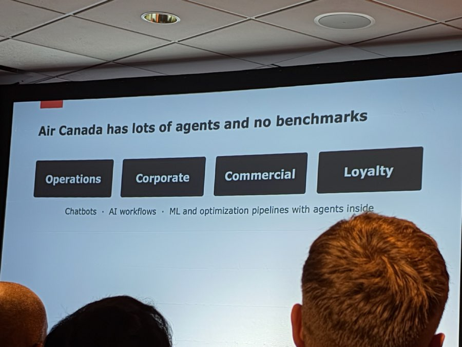
*Air Canada 的四大业务领域，每个都有 chatbot、AI 工作流，以及内含 agent 的 ML pipeline。*

Weill 2026 年 6 月加入 Air Canada。公司很大，覆盖运营、企业职能、商业和会员忠诚度四块，Weill 的团队为这四块都提供 AI 方案：chatbot、AI 工作流，以及内含 agent 的机器学习和优化 pipeline。评估这些 agent 有两个难处。任务太具体，「我们没有任何能依赖的公开 benchmark」。更重要的是，「我们是能搭 agent 的数据科学家……但我们不是领域专家。」专家在别的业务部门，忙自己的工作，很难约到时间。

演讲讲了两个故事，一个在 2024 年，一个在 2026 年，都经过幻灯片顶部标出的同样几个阶段：Problem、Tried、Stuck、New method、Result。

## 1. 2024：一个电信 RAG 项目

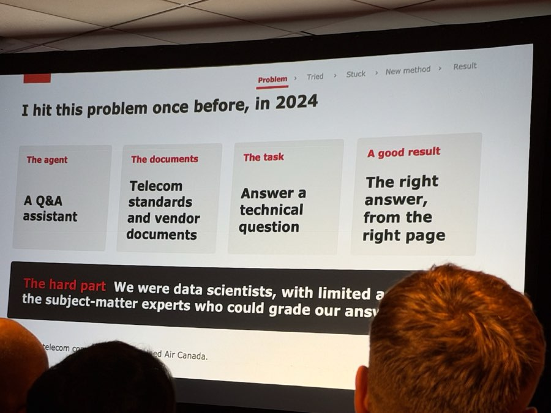
*2024 年的项目：一个基于电信标准和厂商文档的问答助手。*

来 Air Canada 之前，Weill 在另一家公司给电信工程师做问答助手。幻灯片列出了任务：文档是电信标准和厂商文档，任务是回答技术问题，好的结果是「the right answer, from the right page」（对的答案，出自对的那一页）。这个领域很大，大约 10,000 份文档，外加大量厂商文档，而且哪份文档回答哪个问题有它自己的逻辑。「2024 年，所有人都想搭 RAG，」Weill 说，「在 LinkedIn 上看着超级简单。其实不是。」难点用幻灯片的话说：「We were data scientists, with limited access to the subject-matter experts who could grade our answers.」（我们是数据科学家，很难接触到能给我们的答案打分的领域专家。）

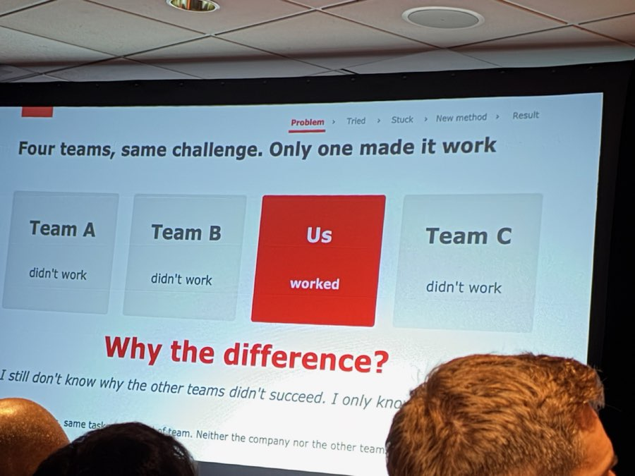
*Team A、B、C 没做成；「Us」做成了。*

Weill 的团队和其他团队在同一个任务上竞争，「两个外部的，一个内部的。不是同时并行，而是分阶段的。」只有 Weill 的方案做成了，意思是「真正交付了价值。大家喜欢这个方案，真的在用。」Weill 很坦白地说了原因：「老实说，我不知道为什么我们做成了而其他团队没有。」大家拿的是同样的文档、同样的任务。

### Tried：每周加一个组件

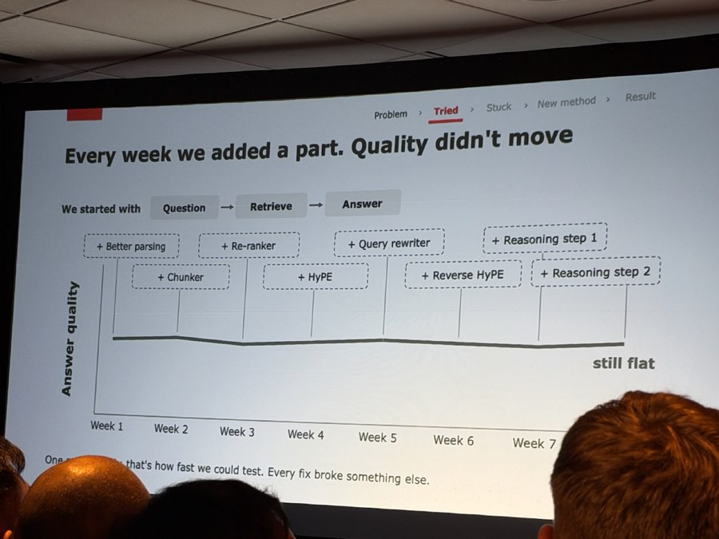
*七周里加了八样东西；答案质量「still flat」（仍然不动）。*

在 RAG 里，问题进入系统，系统检索相关文档，再根据文档写答案。「如果你找到了对的那一页或对的文档，90% 的情况下答案就是对的，」Weill 说，所以难点在检索。团队从 Question → Retrieve → Answer 起步，每周加一样东西：更好的 parsing、一个 chunker、一个 re-ranker、HyPE（hypothetical prompt embeddings，为每个 chunk 生成问题并建索引）、一个 query rewriter、「reverse HyPE」，以及两个推理步骤。七周里答案质量的线一直是平的。幻灯片的脚注：「One try a week: that's how fast we could test. Every fix broke something else.」（一周试一次：我们只能测这么快。每个修复都弄坏了别的东西。）

论文里的技术「在纸面上……对他们有用……但对我们没什么帮助，」Weill 说，「加了复杂度之后，我们发现会弄坏别的东西。原来好用的东西现在不好用了。这才是真正的问题。」

### Stuck：一周只能试一次

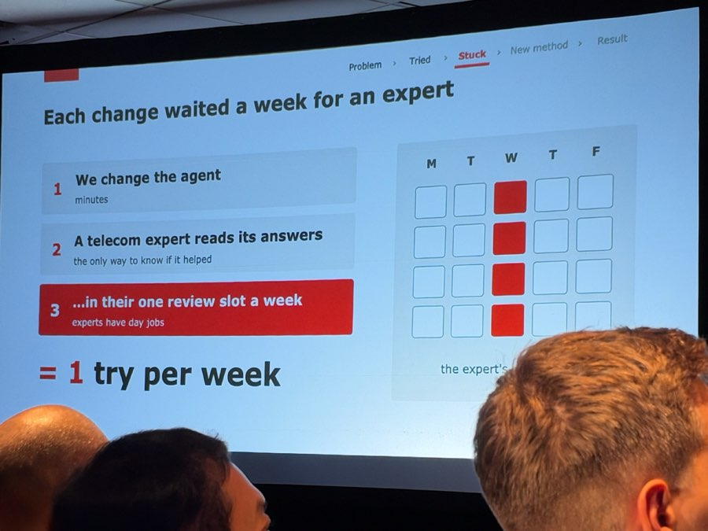
*改 agent 只要几分钟；给它打分要等专家每周唯一的一次评审。*

幻灯片列出了瓶颈。团队几分钟就能改好 agent。让电信专家读它的回答，是「the only way to know if it helped」（知道改动有没有用的唯一办法）。而专家有自己的本职工作，所以每周只有一个评审时段：「= 1 try per week」，配一张只有周三被填上的日历。

这些评审是每周的会议。「我们放一块巨大巨大的屏幕，上面开五个不同的 chatbot，对所有 chatbot 问同一个问题，让专家打分。我更喜欢这个，我更喜欢那个。」专家之间意见并不总一致，有时候专家也不知道答案，得去查。「我们的预算就是一周能试一个方案，这不够快。」

### New method：先写答案

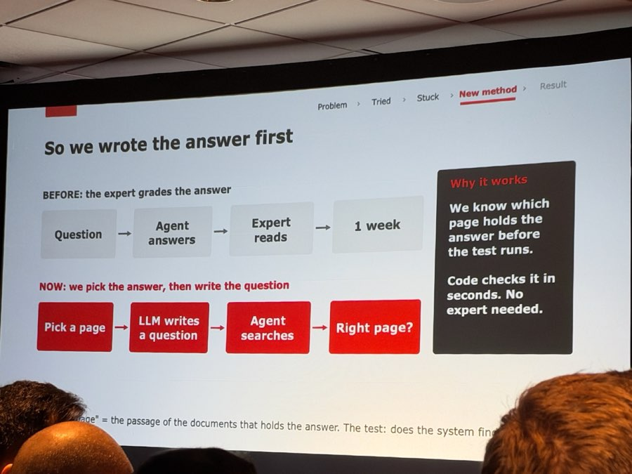
*以前：专家给答案打分。现在：先选页面，再写问题。*

解决办法是把测试的方向倒过来。以前：问题交给 agent，agent 回答，专家读答案，一周过去了。现在：选一页，让 LLM 针对这一页写一个问题，让 agent 去搜，检查它有没有找到那一页。幻灯片上写的「Why it works」：「We know which page holds the answer before the test runs. Code checks it in seconds. No expert needed.」（测试跑之前我们就知道答案在哪一页。代码几秒钟就能检查完。不需要专家。）「对的那一页」就是文档里包含答案的那段内容。

「这里没什么新东西，」Weill 说，「我们把问题倒过来。……做 RAG 的人都知道，这种做法有很多实现。不是我发明的。我只是觉得它非常非常聪明，就记住了。然后想，为什么这个原则不能用到别的任务上？」

### Result：一天试几十次

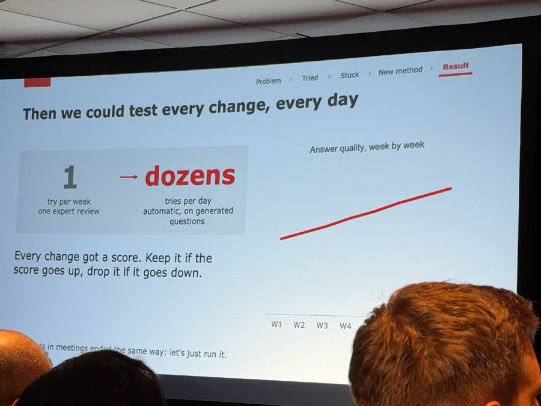
*从一周一次到一天几十次，质量线开始上升。*

「我们从一周一次评估变成一天几十次，」Weill 说，专家给出的准确率分数开始一周比一周高。幻灯片上的规则：「Every change got a score. Keep it if the score goes up, drop it if it goes down.」（每个改动都有分数。分数涨就留，跌就扔。）脚注补充说，会上的争论现在也都以同一句话收场：「let's just run it」（跑一下就知道了）。

很大一部分提升来自做减法。「去掉很多复杂度反而有帮助。那些东西很多都用不着。」真正要紧的是「对的 embedding 模型、对的 chunking、BM25 里对的 alpha」。

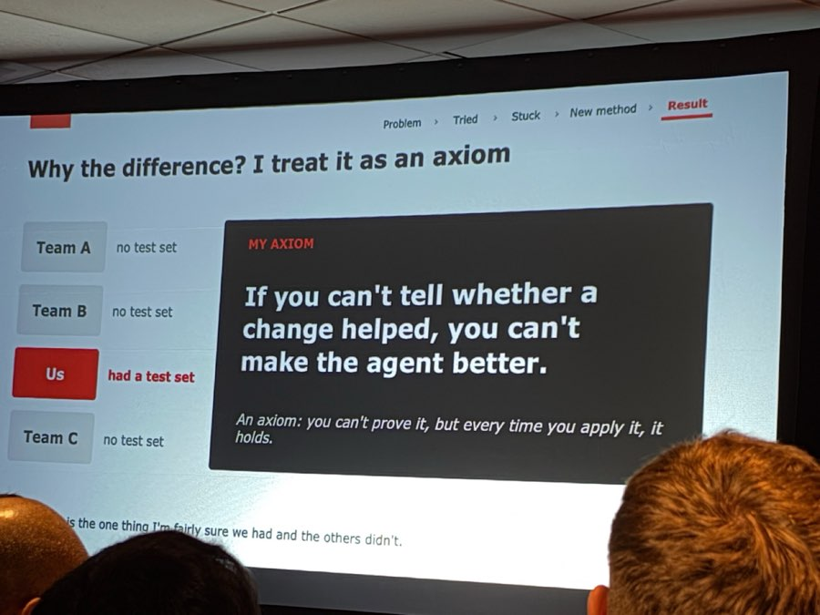
*另外三个团队没有测试集；Weill 的团队有一个。*

Weill 仍然不能确定团队为什么成功，「但我很确定其他团队没有任何测试集。所以他们用的是那种和专家之间的长循环」，也许他们接触专家的机会比 Weill 的团队还多。幻灯片把这个教训写成一条公理：「If you can't tell whether a change helped, you can't make the agent better.」（如果你分辨不出一个改动有没有用，你就没法把 agent 变好。）幻灯片还给出了定义：「An axiom: you can't prove it, but every time you apply it, it holds.」（公理：你证明不了它，但每次用它都成立。）Weill 说这个教训「一直记到今天，已经两年了」。

## 2. 2026：在 Air Canada 审查供应商合同

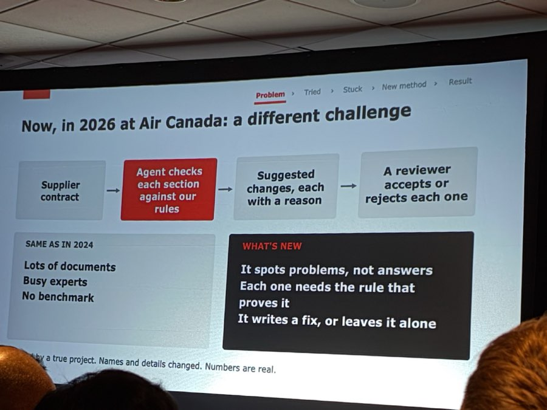
*合同 agent 的流程，从 2024 年延续下来的部分，以及新的部分。*

第二个故事是 Air Canada 当前的一个项目，幻灯片上注明「inspired by a true project. Names and details changed. Numbers are real.」（取材于真实项目。名字和细节有改动，数字是真的。）Air Canada 有很多供应商、很多合同。专家要逐条过每份合同并给出反馈：这条不合规，这条需要重写。这件事又慢又贵，两头都是。如果现在就需要一个供应商，合同却迟迟定不下来，「整条链都会被拖慢。如果漏掉一条条款，代价也很大，因为最后可能会反过来坑我们自己。」业务部门请数据科学团队做一个 agent 把这项工作自动化。

在 agent 的流程里，一份供应商合同进来，agent 对照 Air Canada 的规则逐节检查，生成修改建议，每条都附理由，再由审核人逐条接受或拒绝。幻灯片列出了和 2024 年相同的地方（文档多、专家忙、没有 benchmark；「你可以想象律师按小时收费是什么价，」Weill 说），以及新的地方：agent 要找出问题，而不是回答问题；每个问题都需要能证明它的规则；agent 要么写出修改，要么不动这条条款。

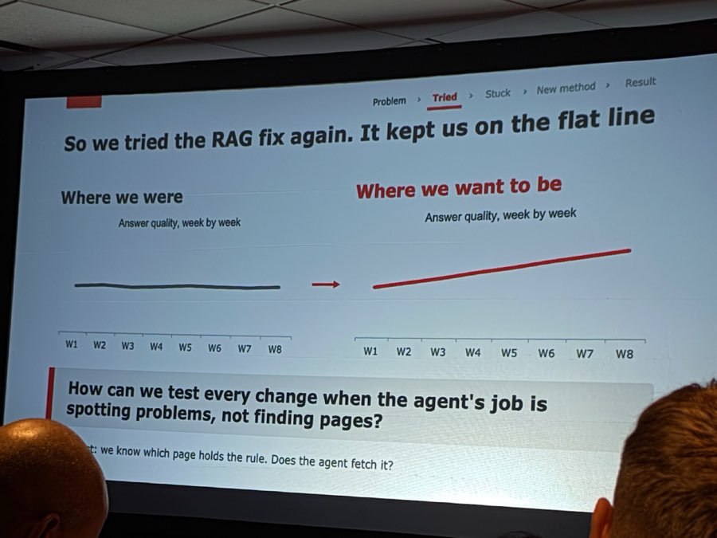
*我们的位置（平的）和想去的位置（上升的）：「How can we test every change when the agent's job is spotting problems, not finding pages?」（agent 的工作是找问题而不是找页面时，怎么测试每一个改动？）*

直接套用 2024 年的办法，团队还是「停在那条平线上」。搜索测试（我们知道哪一页有那条规则，agent 能不能取到它？）覆盖不了 agent 真正的工作。

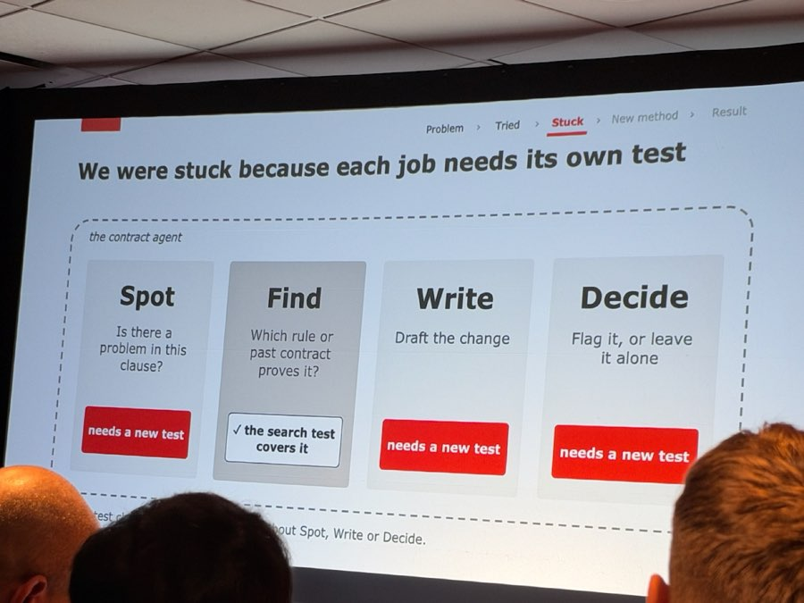
*合同 agent 的四个步骤；搜索测试只覆盖了 Find。*

「这里简化了一些，但 agent 其实有四个步骤，」Weill 说：

| 步骤 | 问题 | 测试覆盖 |
| --- | --- | --- |
| Spot | 这条条款有没有问题？ | 需要新的测试 |
| Find | 哪条规则或过去的合同能证明？ | 搜索测试已覆盖 |
| Write | 起草修改 | 需要新的测试 |
| Decide | 标出来，还是不动 | 需要新的测试 |

比如 Spot，先把合同的每一节归到一个领域，再找缺陷或需要的修改。找支撑文档是 2024 年的问题，已经解决了。另外三个步骤什么都没有。

## 3. 不靠专家建测试集的五种方法

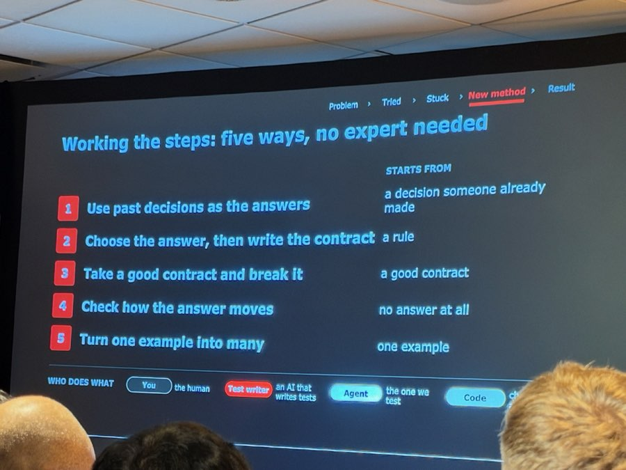
*五种技术，各自的起点，以及几个角色：你、负责写测试的 AI、agent 和代码。*

Weill 介绍了团队用过或试过的五种技术。「我的目的不是炫耀，而是希望给你们一些启发，看怎么把这些技术用到自己的问题上。」每张幻灯片都标出了每一步由谁做：你（人）、test writer（写测试的 AI）、被测的 agent，以及代码。

| # | 技术 | 起点 |
| --- | --- | --- |
| 1 | 用过去的决定当答案 | 别人已经做过的决定 |
| 2 | 先选答案，再写合同 | 一条规则 |
| 3 | 拿一份好合同，把它弄坏 | 一份好合同 |
| 4 | 看答案怎么变 | 根本没有答案 |
| 5 | 一个例子变成很多个 | 一个例子 |

### 技术 1：用过去的决定当答案

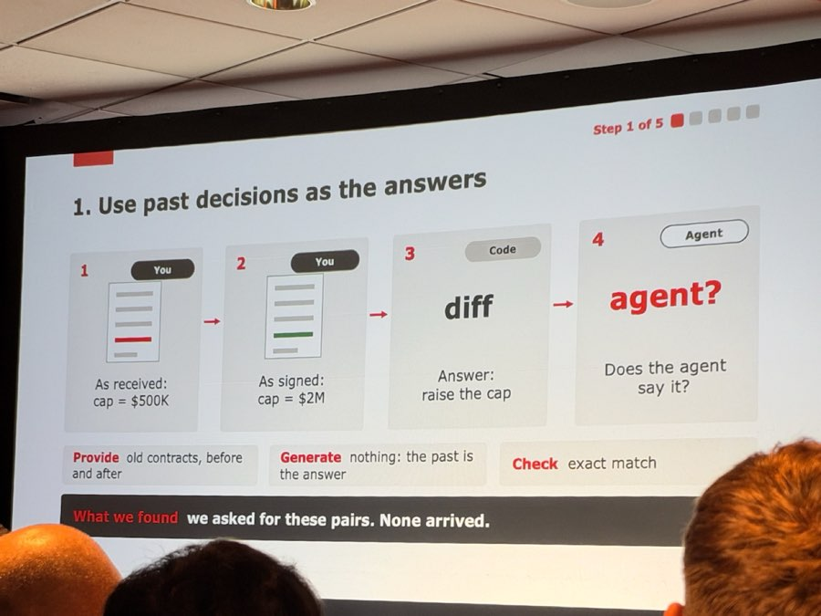
*对比收到的合同和签署的合同；agent 应该标出同样的改动。*

思路是：拿一份收到时的合同（cap = $500K）和签署后的合同（cap = $2M），用代码 diff 出答案（「提高上限」），再用精确匹配检查 agent 是否给出同样的结论。幻灯片上的「What we found」：「we asked for these pairs. None arrived.」（我们要过这些成对的合同，一份都没来。）Weill 说，各团队只保留最终版本，不留原始版本，而且合同要经过谈判。「所以这个办法行不通。」

### 技术 2：先选答案，再写合同

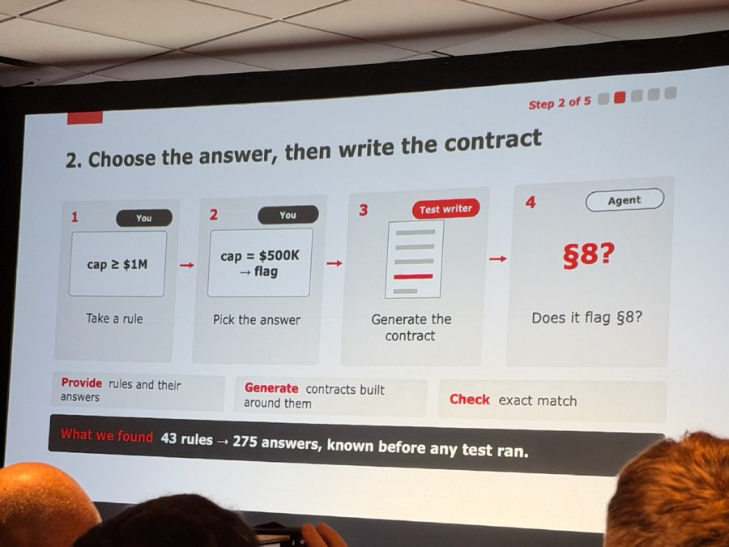
*拿一条规则，挑一个违规的值，围绕它生成一份合同，看 agent 有没有标出那一节。*

从一条规则开始，比如每份 Air Canada 合同都应满足至少 100 万美元的上限。选定答案（上限 $500K，应该被标出），让 test writer 围绕它生成一份合同，再用精确匹配检查 agent 有没有标出那一节（幻灯片上是 §8）。难处在于你得知道规则。有一些来自专家或现有文档，但那「保证不了全覆盖」，所以团队也自己写了一些。结果：「43 rules → 275 answers, known before any test ran.」（43 条规则 → 275 个答案，测试跑之前就已知。）和 RAG 项目一样，「我们把问题埋进去，再看能不能找回来，」Weill 说。

### 技术 3：把好合同弄坏

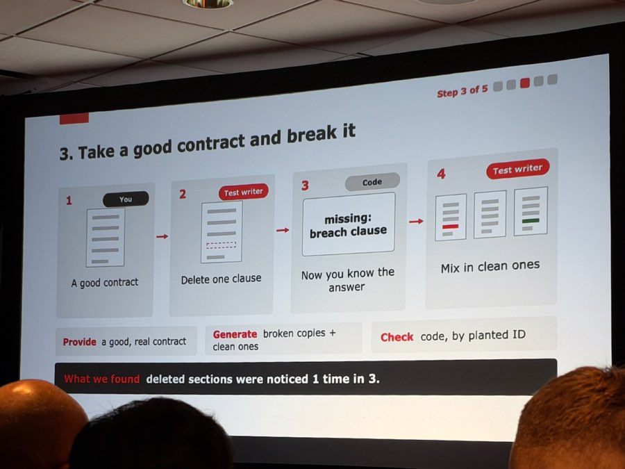
*删掉一条条款，记下删的是哪条，把弄坏的副本和完好的混在一起。*

拿一份真实签署过的合同，让 test writer 删掉一条条款，用代码记下少了什么（比如违约条款），再把弄坏的副本和不该触发任何标记的完好副本混在一起。代码按埋入的 ID 检查。这对 agent 来说很难，因为供应商用的模板各不相同：「知道哪份合同里该有什么，需要动点脑子。」发现是：「deleted sections were noticed 1 time in 3」（被删的部分三次里只发现一次）。Weill 说 agent 漏掉了大部分被删的条款，「所以这是一个非常非常强的 benchmark」，并称它是「我们用过最有力的方法」。（前面介绍列表时，Weill 说的是技术 5「最有力」。）

### 技术 4：看答案怎么变

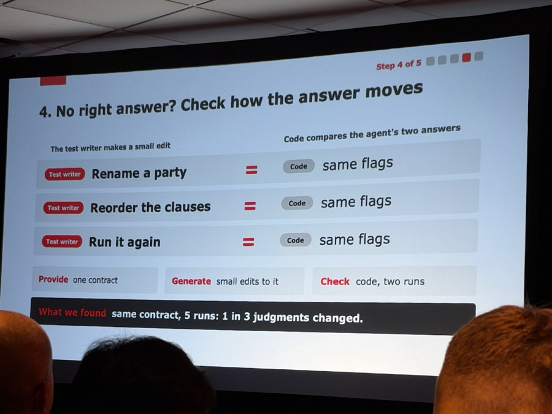
*不该有影响的修改，应该产生同样的标记。*

没有标准答案时，改测一致性。Test writer 把某一方改个名、把条款调个顺序，或者干脆把同一份合同再跑一遍；代码比较 agent 的两次回答，标记应该相同。改供应商的名字或地址「不应该对标记数量有任何影响」。幻灯片上的发现：「same contract, 5 runs: 1 in 3 judgments changed.」（同一份合同跑 5 次：三分之一的判断变了。）全部由代码检查。「你不需要任何 LLM as a judge。上一位讲者已经展示了这有多难。所以我们尽可能远离 LLM as a judge，」Weill 说。

### 技术 5：一个例子变成很多个

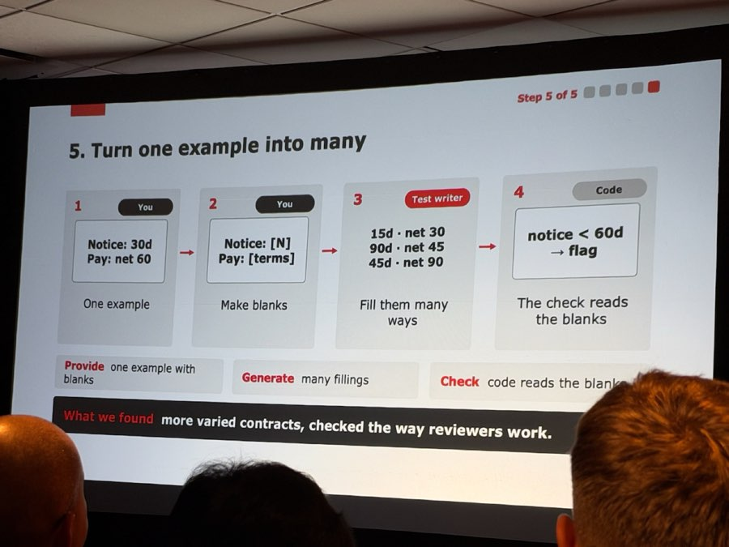
*把一个例子变成模板，用多种方式填空，让检查去读这些空。*

专家本来就在用带空格的合同模板。从一个例子开始（notice: 30 days; pay: net 60），把它变成模板（notice: [N]; pay: [terms]），让 test writer 用多种方式填（15 days 和 net 30，90 days 和 net 45，45 days 和 net 90）。代码检查读取这些空，比如「notice < 60d → flag」。「我们给每个空生成一个数组，」Weill 说，「有些组合违反某些规则，有些不违反。这我们都知道。」整个过程不涉及 LLM，而且「我们的专家已经在用模板，所以可以直接复用」。发现是：「more varied contracts, checked the way reviewers work.」（合同更多样，检查方式和审核人的工作方式一致。）

## 4. 从四周到五分钟

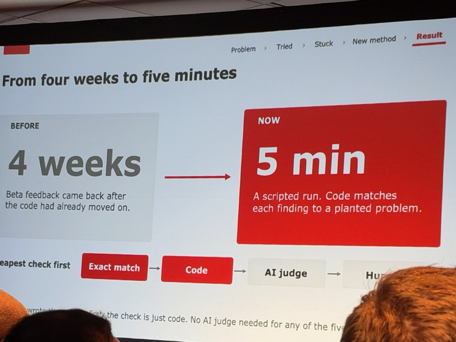
*以前：四周后才有 beta 反馈。现在：五分钟一次脚本化运行。下方：最便宜的检查放在最前。*

以前，beta 反馈要四周，而且「回来的时候代码早就往前走了」。现在，「a scripted run. Code matches each finding to a planted problem」（一次脚本化运行，代码把每个发现和埋入的问题对上），只要五分钟。底部的一条梯子把检查方式按成本从低到高排：exact match、code、AI judge、human。脚注：因为团队先写了答案，「the check is just code. No AI judge needed for any of the five.」（检查就是代码。五种方法都不需要 AI judge。）

Weill 在这一点上讲了好一会儿。精确匹配和代码都很快。「一旦你踏进 LLM as a judge……它可以很花哨，也可以很有用。但太难了。我们从 LLM as a judge 那里得到的噪声，比我们在搭的 agent 本身的噪声还多。解决这个问题几乎和解决真正的问题一样难。」事实核查之类的技术是有的，「但需要的工作量太大了，这个项目我们没找到合适的。」

## 5. 同样的办法不止用于合同

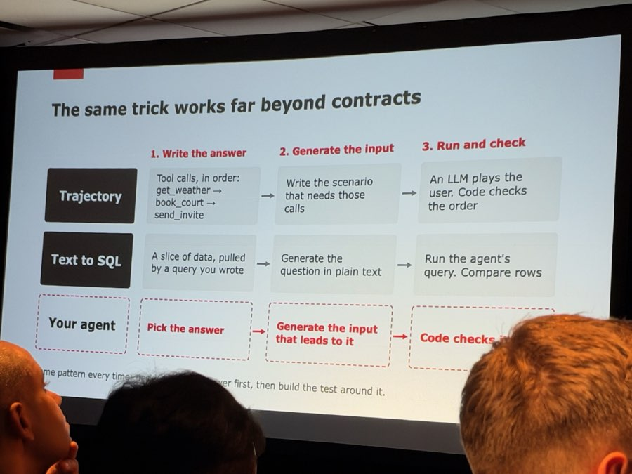
*写答案、生成输入、运行并检查：用于轨迹、text-to-SQL，以及你自己的 agent。*

幻灯片把这个三步模式（写答案、生成输入、运行并检查）套用到其他类型的 agent 上：

| Agent | 1. 写答案 | 2. 生成输入 | 3. 运行并检查 |
| --- | --- | --- | --- |
| Trajectory | 按顺序的 tool call：`get_weather` → `book_court` → `send_invite` | 写一个需要这些调用的场景 | 一个 LLM 扮演用户；代码检查顺序 |
| Text to SQL | 用你写的查询拉出的一片数据 | 用自然语言生成问题 | 运行 agent 的查询；比较行 |
| Your agent | 选定答案 | 生成能导向这个答案的输入 | 代码检查 |

Air Canada 的另一个项目要求 agent 按特定顺序调用 endpoint；团队知道预期的顺序，生成一个需要这个顺序的故事，让 LLM 扮演用户，然后检查 trace。这个模式「不是什么都适用」，Weill 说，「有时候我们得重新设计方案来适配这个范式，即使会稍微偏离最初的设计。按最初的设计我们没法评估它。我们换成了真正能评估的东西。」

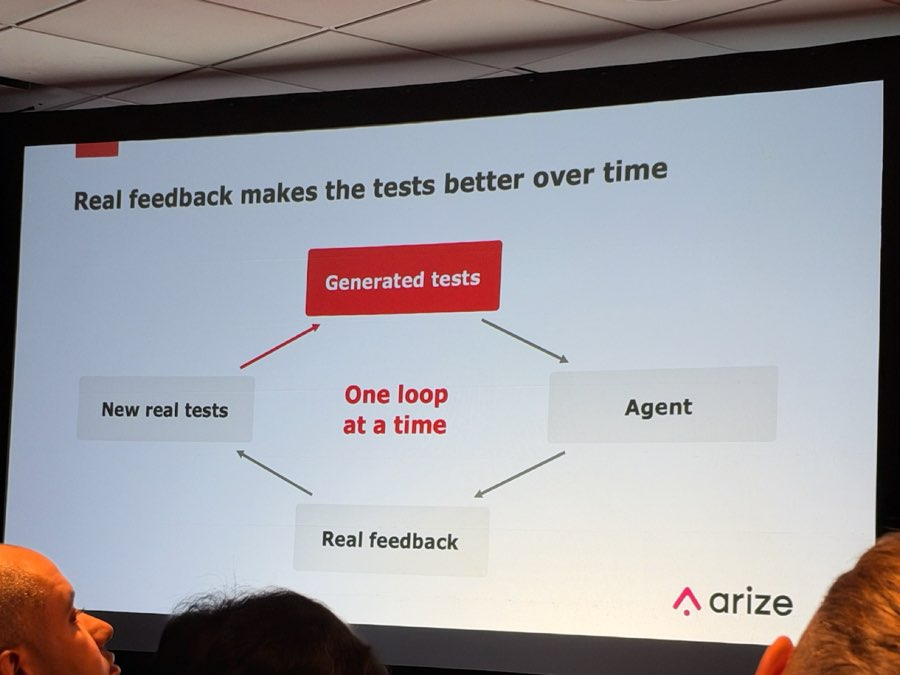
*生成的测试、agent、真实反馈、新的真实测试：「One loop at a time.」（一次一圈。）角落里有一个 Arize 的 logo。*

生成的测试不是终点。幻灯片上的循环从生成的测试到 agent，到真实反馈，到新的真实测试，再回到起点。Weill 说，专家的反馈不直接用来修 agent：「我们用这些反馈生成更好的测试。更好的 prompt。关于怎么删条款的更好的想法。」「这个可以用 Arize 来做。那里有很多工具。谢谢邀请。」

## 6. 结论

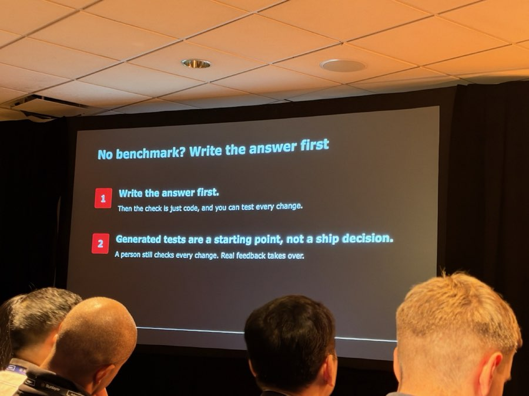
*两条要点。*

结论幻灯片有两点。第一：「Write the answer first. Then the check is just code, and you can test every change.」（先写答案。这样检查就只是代码，每个改动都能测。）第二：「Generated tests are a starting point, not a ship decision. A person still checks every change. Real feedback takes over.」（生成的测试是起点，不是上线决定。每个改动仍然要有人检查。之后由真实反馈接手。）生成的测试「不足以判断产品能不能上线，」Weill 说，「它不是方案的 go/no-go。」

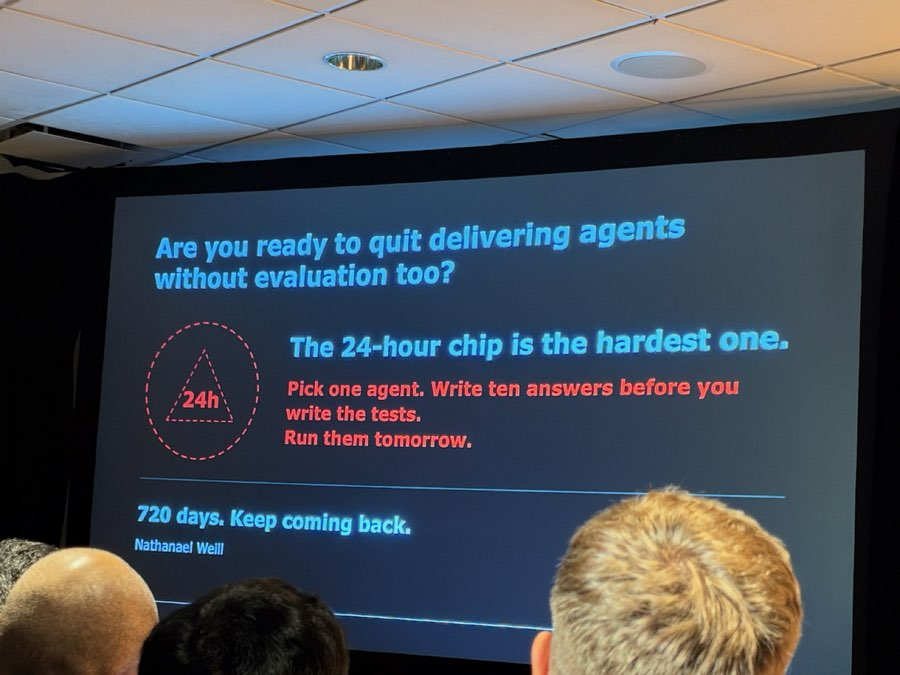
*收尾幻灯片，回到互助小组的设定。*

最后一张幻灯片回到开场的玩笑：「The 24-hour chip is the hardest one. Pick one agent. Write ten answers before you write the tests. Run them tomorrow.」（24 小时的纪念章最难拿。挑一个 agent。写测试之前先写十个答案。明天就跑。）落款是「720 days. Keep coming back. — Nathanael Weill.」（720 天。记得常回来。）Weill 表示愿意帮助任何想「戒掉不做评估就发布 agent」的人。

---

**链接：** [Schedule](https://ai.engineer/nyc/2026/schedule?session=c4ba0138-6f6d-4780-93a1-4d8f0c478339) · [Video: How to Test AI Agents When No Benchmark Exists](https://www.youtube.com/watch?v=c_SPW__jF9w) · [RAGAS paper](https://arxiv.org/abs/2309.15217)（schedule 摘要里拿来对照 RAG evaluation 的参照）· [Hypothetical Prompt Embeddings (HyPE) paper](https://arxiv.org/pdf/2607.29402) · [Nathanael Weill on Medium](https://medium.com/@naweill)

这场 session 的摘要以 RAG evaluation 作为对照：RAGAS 的 faithfulness、context relevance 和 answer relevance 指标把几个月的工作变成了一套现成的打法；摘要承诺的东西「won't be RAGAS for agents, but it will be enough to get started on Monday」（不会是 agent 版的 RAGAS，但足够让你周一就开工）。两个故事的反馈周期不同（2024 年是每周一次专家评审，2026 年是四周的 beta 反馈）。视频以 Weill 的致谢结束，没有 Q&A。本文依据官方视频字幕、作者拍的幻灯片照片和上面列出的资料（作者现场的录音无法使用）。[精确笔记](../precise/10-13-1105-write-the-answer-first-generating-eval-d.md)（中文）保留了时间戳，并完整记录了各来源之间不一致的地方。
